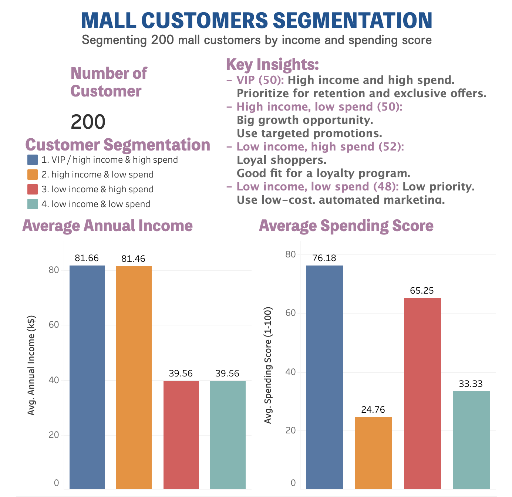

# Mall Customer Segmentation

Segmented 200 mall customers into 4 groups by annual income and spending score, then built an interactive Tableau dashboard to present the results.

## Dashboard
[View the interactive dashboard on Tableau Public](https://public.tableau.com/views/Dashboard_17929254637600/Dashboard1)



## Objective
Help a mall's marketing team understand which customers to retain, grow, reward or deprioritize.

## Tools
- **Python (Pandas):** data cleaning and segmentation
- **Excel:** pivot table summary
- **Tableau Public:** dashboard

## Segments

| Segment | Customers | Profile | Recommended action |
|---|---|---|---|
| 1. VIP | 50 | High income, high spend | Retention and exclusive offers |
| 2. High income, low spend | 50 | High income, low spend | Targeted promotions (biggest growth opportunity) |
| 3. Low income, high spend | 52 | Low income, high spend | Loyalty program |
| 4. Low income, low spend | 48 | Low income, low spend | Low-cost automated marketing |

## Key Findings
- VIP customers average about **81.7k** income and a spending score of **76**.
- High-income, low-spend customers earn about the same (**81.5k**) but score only **25** on spending. This is the biggest untapped group.
- Low-income, high-spend customers score **65** despite earning about **39.6k**, so they are likely loyal shoppers.

## Files
| File | Description |
|---|---|
| `analyze_customer.py` | Python script for segmentation |
| `Mall_Customers_Segmented.csv` | Data with segment labels |
| `Mall_Customers_Enhanced.csv` | Data with extra features |
| `Mall_Customers_Segmented_Excel...` | Excel version with pivot table summary |

## How to run
```bash
pip install pandas
python analyze_customer.py
```
